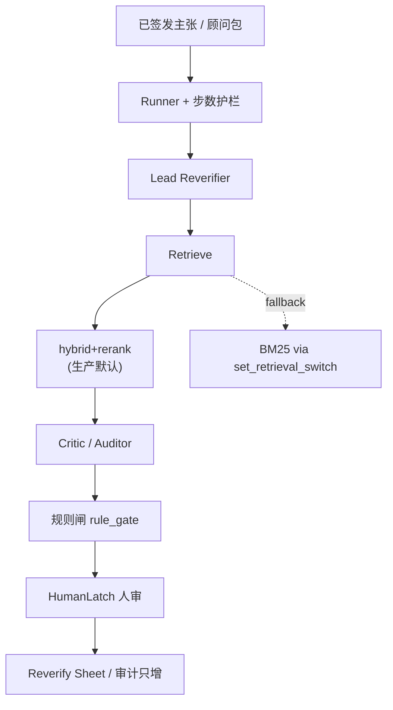

# FreshLatch 结构总览（2026-10）

> **现行结构页。** 默认检索臂与对外口径以 [`docs/ops/口径一页纸.md`](../ops/口径一页纸.md)、[`CONTEXT.md`](../../CONTEXT.md)、[`docs/evidence/retrieval-decision.md`](../evidence/retrieval-decision.md) 为准。  
> 2026-09「现状四闸」规格图已归档：`docs/_archive/2026-10/architecture/`（SQLite+BM25 /「尚未建立」叙事，**不是**本页现况）。  
> 近端垂直：[`docs/product/FreshLatch.md`](../product/FreshLatch.md)（顾问报告）。

## 1. 一句话

已签发主张在 T1 是否仍可复验：过期、冲突、无 T1 原文支持不得保持绿灯；人决定作废或续命（HumanLatch）。

## 2. 主路径（2026-10）

| 层 | 现行要点 |
|----|----------|
| 存储 | SQLite（语料 / checkpoint / 台账）；**存储 ≠ 检索默认臂** |
| 检索 | 生产默认 `hybrid+rerank`（本地 `BAAI/bge-reranker-base`，重排 hybrid top-10） |
| 回退 | `set_retrieval_switch("bm25")`；向量失败记 `bm25_fallback` |
| Agent | Lead / Critic 真 Agent；Auditor 单轮 structured-output，无放行权 |
| 闸 | 规则闸纯函数；stale/unknown 不得绿灯 |
| 人 | HumanLatch（LangGraph interrupt）；复验单 UI，非聊天主裁决 |
| 审计 | patch_events / latch_log 只增 |

## 3. 与旧「四闸」图的关系

| | 旧四闸（archived） | 本页（2026-10） |
|--|-------------------|-----------------|
| 检索叙事 | 易读成 SQLite+BM25 现况 | 明确 hybrid+rerank + BM25 回退 |
| 产品状态 | 含「尚未建立」规格语 | 工程 L4 / 可回归拒答；产品 CONDITIONAL GO（见口径一页纸） |
| 入口 | `docs/_archive/2026-10/architecture/` 旧四闸全文 | **本页** + 口径一页纸 |

## 4. 相关入口

- 贡献边界：[`docs/contribution-boundary.md`](../contribution-boundary.md)
- 模块规格图（轻修后）：[`docs/spec/00-架构总览.md`](../spec/00-架构总览.md)
- 归档 hub：[`docs/_archive/2026-10/README.md`](../_archive/2026-10/README.md)
- 历史分析见 archive：[`docs/_archive/2026-10/evidence/`](../_archive/2026-10/evidence/)
