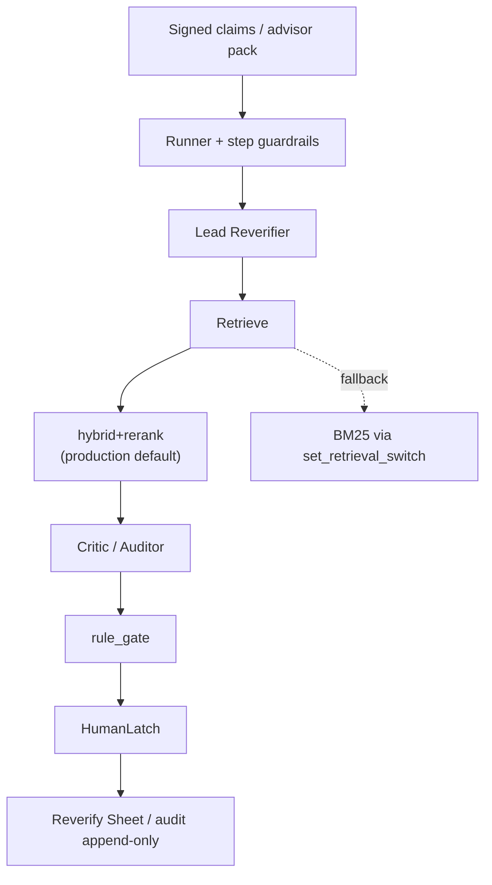

# FreshLatch structure overview (2026-10)

> **Current structure page.** Default retrieval arm and external framing follow [`docs/messaging-one-pager.md`](../messaging-one-pager.md), [`CONTEXT.md`](../../CONTEXT.md) (glossary pointer), and [`docs/evidence/retrieval-decision.md`](../evidence/retrieval-decision.md).  
> The 2026-09 "four-gate status" diagram is archived: `docs/_archive/2026-10/architecture/` (SQLite+BM25 / "not yet built" narrative — **not** this page's current state).  
> Near-term vertical: [`docs/product/FreshLatch.md`](../product/FreshLatch.md) (advisor reports).

## 1. One sentence

Whether a signed claim is still verifiable at T1: expired, conflicting, or T1-unsupported claims must not stay green; a human voids or renews them (HumanLatch).

## 2. Main path (2026-10)

| Layer | Current points |
|-------|----------------|
| Storage | SQLite (corpus / checkpoint / ledger); **storage ≠ retrieval default arm** |
| Retrieval | Production default `hybrid+rerank` (local `BAAI/bge-reranker-base`, reranks hybrid top-10) |
| Fallback | `set_retrieval_switch("bm25")`; vector failure records `bm25_fallback` |
| Agents | Lead / Critic are real agents; Auditor is single-turn structured-output with no release authority |
| Gate | Rule gate is a pure function; stale/unknown must not go green |
| Human | HumanLatch (LangGraph interrupt); Reverify Sheet UI, not chat-as-verdict |
| Audit | patch_events / latch_log are append-only |

## 3. Relation to the old "four-gate" diagram

| | Old four-gate (archived) | This page (2026-10) |
|--|--------------------------|---------------------|
| Retrieval narrative | Easy to read as SQLite+BM25 current state | Explicit hybrid+rerank + BM25 fallback |
| Product status | Includes "not yet built" spec language | Engineering L4 / regressible refusal; product CONDITIONAL GO (see messaging one-pager) |
| Entry | `docs/_archive/2026-10/architecture/` full old four-gate text | **This page** + messaging one-pager |

## 4. Related entries

- Contribution boundary: [`docs/contribution-boundary.md`](../contribution-boundary.md)
- Module spec diagram (lightly revised): [`docs/spec/00-架构总览.md`](../spec/00-架构总览.md)
- Archive hub: [`docs/_archive/2026-10/README.md`](../_archive/2026-10/README.md)
- Historical analysis in archive: [`docs/_archive/2026-10/evidence/`](../_archive/2026-10/evidence/)
- Glossary SSOT: [`docs/glossary.md`](../glossary.md)
